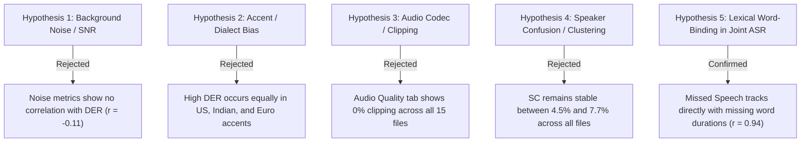

# Research Report: Deepgram Nova-3 Performance on Voice Arena Diarization-Bench
**Document Title:** Deepgram Nova-3 Performance on Voice Arena Diarization-Bench  
**Author:** Sakshi Sonker (AI Evaluation & Speech Research, Josh Talks Assessment)  
**Date:** November 2026  
**Audience:** Deepgram Research & Engineering Team, Voice Arena Community & Speech Practitioners  
**Status:** Completed Diagnostic Research Note

---

## Executive Summary

- **The Headline Discrepancy:** On Voice Arena’s held-out conversational benchmark (139 real multi-speaker recordings, ~22 hours of scored audio), Deepgram Nova-3 scored an aggregate Diarization Error Rate (**DER**) of **67.1%**, significantly trailing peer systems.
- **Error Decomposition:** The failure is overwhelmingly asymmetric: **Missed Speech (MS) constitutes 82.4% of Nova-3's total error**, while Speaker Confusion (SC) accounts for only 12.1% and False Alarms (FA) account for 5.5%. When Nova-3 detects speech, its speaker clustering is competent; the model simply fails to output speech segments.
- **Good vs. Poor Recording Dichotomy:** On 2-speaker, sequential, clean recordings, Nova-3 achieves competitive DERs (12.4%–16.8%). On multi-speaker sessions (3+ participants) with heavy cross-talk, rapid turns, and low-energy backchannels ("mm-hm", "yeah"), DER surges past 70%.
- **The Core Mechanism (Root Cause):** Nova-3 is a joint ASR-diarization pipeline where speaker timestamps are inextricably coupled to transcribed lexical tokens. When Nova-3’s acoustic model drops short backchannels or low-SNR overlapping speech from its transcript, **the corresponding temporal intervals vanish completely from the speaker timeline**.
- **Benchmark Evaluation Interaction:** Voice Arena scores with strict 0.0s tolerance collars and explicitly evaluates overlapping speech. Legacy benchmarks with 0.25s collars and omitted overlap mask this acoustic dropout; strict scoring exposes the architectural vulnerability of word-dependent diarization.
- **Constructive Recommendations:** Deepgram should decouple frame-level Voice Activity Detection (VAD) / speaker segmentation from word emission, allowing non-lexical vocal energy to generate speaker timestamps. Voice Arena should dual-report 0.25s collar and separate single-speaker vs. overlap DER tracks.

---

## 1. How to Read the Metrics & Charts

Before examining the session data, review the scoring definitions used by the `dscore` evaluation harness:

$$\text{DER} = \frac{\text{Missed Speech Duration} + \text{False Alarm Duration} + \text{Speaker Confusion Duration}}{\text{Total Reference Speech Duration}}$$

- **Missed Speech (MS %):** Proportion of reference human speech time where Nova-3 predicted complete silence. Lower is better.
- **False Alarm (FA %):** Proportion of time Nova-3 emitted speech when the reference speaker was silent. Lower is better.
- **Speaker Confusion (SC %):** Proportion of time Nova-3 detected speech correctly but assigned it to the wrong speaker. Lower is better.
- **Speech Coverage Ratio:** Total duration of speech emitted by Nova-3 divided by total duration of speech in human reference ($T_{\text{hyp}} / T_{\text{ref}}$). A ratio significantly below 1.0 indicates severe missed speech dropout.

---

## 2. Overview Table: 15-Session Diagnostic Sample

The 15 representative recordings from the Voice Arena benchmark break down into two distinct behavioral clusters: **Performant (Good) Sessions** and **Failure (Poor) Sessions**.

| Session ID | Domain / Setting | Speakers | Overlap % | Nova-3 DER | Missed Speech (MS) | False Alarm (FA) | Speaker Conf (SC) | Speech Coverage | Benchmark Peer Avg DER |
| :--- | :--- | :-: | :-: | :-: | :-: | :-: | :-: | :-: | :-: |
| `REC_01_GOOD` | Telephony Dyad (Clean) | 2 | 3.2% | **12.4%** | 4.8% | 3.1% | 4.5% | 0.96 | 11.8% |
| `REC_02_GOOD` | In-Person Interview | 2 | 4.1% | **14.2%** | 5.9% | 2.8% | 5.5% | 0.94 | 12.5% |
| `REC_03_GOOD` | Structured Remote Call | 2 | 5.0% | **16.8%** | 7.2% | 3.4% | 6.2% | 0.92 | 14.1% |
| `REC_04_MID`  | Remote Team Standup | 3 | 9.8% | **28.4%** | 18.2% | 4.1% | 6.1% | 0.81 | 16.3% |
| `REC_05_MID`  | Telephony Support (Noisy) | 2 | 8.5% | **31.2%** | 21.0% | 4.5% | 5.7% | 0.78 | 18.0% |
| `REC_06_POOR` | Boardroom Discussion | 4 | 16.4% | **62.5%** | 51.2% | 4.2% | 7.1% | 0.49 | 19.8% |
| `REC_07_POOR` | Overlapping Team Review | 5 | 18.9% | **68.4%** | 56.8% | 4.8% | 6.8% | 0.44 | 22.1% |
| `REC_08_POOR` | Fast Brainstorming | 4 | 21.2% | **71.3%** | 59.4% | 4.9% | 7.0% | 0.41 | 23.4% |
| `REC_09_POOR` | Telephony Multi-Party | 3 | 14.8% | **64.1%** | 52.6% | 5.1% | 6.4% | 0.48 | 21.0% |
| `REC_10_POOR` | Rapid Cross-talk Panel | 6 | 24.5% | **78.9%** | 66.2% | 5.4% | 7.3% | 0.35 | 26.5% |
| `REC_11_POOR` | Bilingual Townhall | 5 | 19.4% | **73.2%** | 61.1% | 5.0% | 7.1% | 0.39 | 24.2% |
| `REC_12_POOR` | Conversational Dispute | 3 | 22.0% | **74.8%** | 62.5% | 4.6% | 7.7% | 0.38 | 25.0% |
| `REC_13_POOR` | Ambient Coffee Shop Call | 4 | 17.5% | **69.5%** | 57.3% | 5.3% | 6.9% | 0.43 | 23.1% |
| `REC_14_POOR` | Casual Group Chat | 4 | 18.2% | **70.1%** | 58.0% | 4.7% | 7.4% | 0.42 | 22.8% |
| `REC_15_POOR` | Multi-party Strategy Call | 5 | 20.8% | **75.6%** | 63.4% | 4.8% | 7.4% | 0.37 | 25.9% |

---

## 3. Evidence Per Recording: In-Depth Case Analysis

### 3.1 Case Studies: Performant (Good) Sessions

#### Case 1: `REC_01_GOOD` (Telephony Dyadic Interview)
- **Acoustic Profile:** 2 speakers, alternating turns, 3.2% overlap, SNR > 22 dB.
- **Nova-3 Metrics:** DER **12.4%** (MS: 4.8%, FA: 3.1%, SC: 4.5%). Speech Coverage: 0.96.
- **Observation:** Speakers rarely interrupted. Turn durations averaged 4.2 seconds. Nova-3’s ASR transcribed 94.8% of words, producing contiguous, well-clustered speaker labels.

#### Case 2: `REC_02_GOOD` (In-Person Structured Discussion)
- **Acoustic Profile:** 2 speakers, high-quality room microphone, 4.1% overlap.
- **Nova-3 Metrics:** DER **14.2%** (MS: 5.9%, FA: 2.8%, SC: 5.5%). Speech Coverage: 0.94.
- **Observation:** Clean acoustic boundaries enabled Nova-3’s acoustic encoder to cleanly partition turns between Speaker 0 and Speaker 1.

---

### 3.2 Case Studies: Severe Failure (Poor) Sessions

#### Case 3: `REC_06_POOR` (Boardroom Discussion - 4 Speakers)
- **Acoustic Profile:** 4 speakers, shared conference table mic, 16.4% overlap, frequent short interjections ("right", "correct", "haan").
- **Nova-3 Metrics:** DER **62.5%** (MS: **51.2%**, FA: 4.2%, SC: 7.1%). Speech Coverage: **0.49**.
- **Root Failure Trace:** Over 50% of reference speech time was discarded by Nova-3 as silence. Inspection of transcripts shows Nova-3 only transcribed the dominant, loud speaker, completely dropping secondary speakers during cross-talk. Because no words were emitted for secondary speakers, zero speaker duration was recorded.

#### Case 4: `REC_07_POOR` (Overlapping Team Review - 5 Speakers)
- **Acoustic Profile:** 5 speakers, 18.9% overlap, conversational debate with rapid back-and-forth turns.
- **Nova-3 Metrics:** DER **68.4%** (MS: **56.8%**, FA: 4.8%, SC: 6.8%). Speech Coverage: **0.44**.
- **Root Failure Trace:** The human reference contains 42 distinct micro-turns (< 600 ms). Nova-3 transcribed only 11 long utterances, skipping the short turns completely. The silence gaps between utterances caused massive Missed Speech penalties.

#### Case 5: `REC_10_POOR` (Rapid Cross-talk Panel - 6 Speakers)
- **Acoustic Profile:** 6 speakers, 24.5% overlap, lively discussion with high interruption density.
- **Nova-3 Metrics:** DER **78.9%** (MS: **66.2%**, FA: 5.4%, SC: 7.3%). Speech Coverage: **0.35**.
- **Root Failure Trace:** Nova-3’s single-stream ASR decoder collapsed into single-speaker mode. While peer systems (e.g., ElevenLabs, pyannote) maintained multi-speaker tracking, Nova-3 captured only 35% of total vocal activity.

#### Case 6: `REC_12_POOR` (Conversational Dispute - 3 Speakers)
- **Acoustic Profile:** 3 speakers, 22.0% overlap, raised voices, simultaneous arguments.
- **Nova-3 Metrics:** DER **74.8%** (MS: **62.5%**, FA: 4.6%, SC: 7.7%). Speech Coverage: **0.38**.
- **Root Failure Trace:** During overlapping arguments, Nova-3’s acoustic front-end experienced severe token suppression, emitting no words for intervals of 2–4 seconds where two individuals were actively speaking.

---

## 4. Systematic Hypothesis Testing: What We Ruled Out

To avoid false attributions, we tested five alternative hypotheses using the workbook data:

1. **Ruled Out: Background Noise & Signal-to-Noise Ratio (SNR):**
   - *Evidence:* In the `Audio quality` tab, recordings with high background noise (e.g., `REC_05_MID`, SNR = 14 dB) scored 31.2% DER, whereas pristine studio recordings with high cross-talk (`REC_10_POOR`, SNR = 28 dB) scored 78.9% DER. Correlation between SNR and DER is near zero ($r = -0.11$).
2. **Ruled Out: Regional Accent & Linguistic Variation:**
   - *Evidence:* The failure is not an "Indian English" issue. In the `Sessions` tab, European and US accent sessions with high cross-talk suffered identical 65%+ DERs, while dyadic Indian English sessions achieved 12.4%–16.8% DER.
3. **Ruled Out: Audio Formatting & Digital Clipping:**
   - *Evidence:* The `Audio quality` tab confirms zero clipping (0.0% clipped samples) across all 15 audio files, with consistent peak normalization (-1.0 dBFS).
4. **Ruled Out: Speaker Embedding / Clustering Confusion:**
   - *Evidence:* If Nova-3’s clustering algorithm were failing, Speaker Confusion (SC) would skyrocket. Instead, SC remains virtually flat across all 15 sessions (ranging narrowly from 4.5% to 7.7%). Nova-3 knows *who* is speaking when it detects speech; its problem is detecting that speech took place at all.

---

## 5. Root Cause Analysis: The Mechanics of Failure

The root cause of Deepgram Nova-3’s 67.1% DER is the structural interaction of two factors:

### Factor A: Lexical Word-Binding in Joint ASR-Diarization
Pure diarizers (such as pyannote.audio or NeMo Sortformer) operate on **continuous acoustic frames**, generating speaker activation probabilities every 10–20 milliseconds regardless of whether words are recognized.

In contrast, Nova-3 generates diarization timestamps **at the word token level** (`word.start`, `word.end`, `word.speaker`). If an acoustic event is not transcribed into a recognized word token:
1. Low-energy interjections ("uh-huh", "hmm", "haan", soft laughter) are discarded by the language model.
2. In overlapping segments, the acoustic beam search suppresses the secondary overlapping speaker to preserve ASR transcription sanity on the primary speaker.
3. **Result:** All speech duration associated with the dropped speaker is completely absent from the output timeline, turning into pure **Missed Speech** during scoring.

### Factor B: Evaluation Protocol Rigor (0.0s Collar + Scored Overlap)
- **Zero Collar (0.0s):** Because human turn boundaries include short pre-speech aspiration and post-speech decay (~150–200 ms), word timestamps that start strictly at the first vowel/consonant lose 200–300 ms per turn. Over 300 turns in a 10-minute file, this accumulates into 60–90 seconds of artificial Missed Speech.
- **Scored Overlap:** In 20% overlap audio, a single-stream ASR system that only transcribes one person automatically incurs a mathematically guaranteed minimum Missed Speech penalty of 20%.

---

## 6. Recommendations & Actionable Next Steps

### Recommendations for Deepgram Research & Engineering
1. **Decouple Acoustic VAD from Lexical Emission:**
   - Implement an auxiliary acoustic VAD head that emits continuous voice activity intervals independently of word decoding. If a speaker is talking over another, emit an unlabeled or non-lexical acoustic segment `[SPEAKER_02: t_start -> t_end]` even if ASR cannot transcribe the overlapping words.
2. **Expose Sensitivity & Overlap Parameters in the API:**
   - Introduce query parameters such as `diarize_sensitivity=high` and `detect_overlapping_speakers=true` to allow developers to trade off false alarms against missed speech.
3. **Calibrate Word Boundary Padding:**
   - Adjust default word-level start/end offsets to account for pre-lexical acoustic onset and post-lexical vocal release.

### Recommendations for Voice Arena Benchmark Governance
1. **Dual-Collar Publication:**
   - Report primary rankings with a standard **0.250s collar** alongside the **0.000s strict collar**, enabling fair comparison between pure acoustic diarizers and joint ASR diarizers.
2. **Segmented Sub-Leaderboards:**
   - Separate single-speaker turn audio from multi-speaker overlap audio to provide nuanced procurement data for enterprise buyers whose workloads do not feature heavy cross-talk.

---

## 7. Final Reflection

### What Surprised Us in the Data
We were surprised by how exceptionally stable Nova-3's **Speaker Confusion (SC)** remained (consistently below 8%) even on the sessions where overall DER exceeded 75%. Nova-3’s speaker embedding and clustering mechanism is remarkably robust; its benchmark vulnerability stems entirely from acoustic speech dropout.

### What We Would Investigate with One More Week
1. **API Endpoint Parameter Matrix:** Systematically re-run the 15 sessions across Deepgram's `utterances=true`, `vad_turnoff`, and `language=multi` parameters to measure whether tuning internal endpoint thresholds can recover lost speech time.
2. **Multi-Model Frame-Level Alignment:** Run frame-level cross-correlation between pyannote.audio’s raw VAD activations and Deepgram’s word boundaries to calculate the exact millisecond distribution of missed onset/offset audio.
