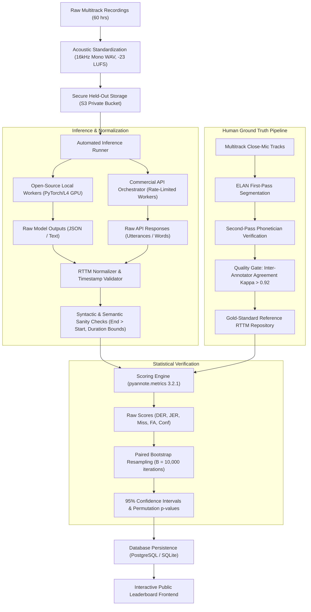

# Speaker Diarization Benchmark & Evaluation Methodology
**Platform:** Voice of India / Josh Talks Diarization Benchmark  
**Author:** Sakshi Sonker (AI Evaluation & Growth Assessment, Josh Talks)  
**Version:** 1.0 (Production Benchmark Design)  
**Target Date:** November 2026  

---

## 1. Executive Summary & Purpose

### 1.1 Purpose of the Benchmark
Speaker diarization answers the question **"who spoke when"** in an audio recording without prior knowledge of the speakers' identities or voice profiles. While public academic benchmarks (such as AMI, VoxConverse, and CALLHOME) provide foundational baselines, enterprise applications operating across India encounter severe real-world distribution shifts: heavy linguistic code-switching (e.g., Hinglish, Tanglish), cross-talk, reverberant conference rooms, non-stationary background noise (ceiling fans, traffic), telephone narrowband artifacts (8 kHz G.711), and diverse vocal timbres across gender and age.

The **Voice of India Speaker Diarization Leaderboard** is established as an independent, transparent, and reproducible evaluation authority. Its mandate is to measure how commercial speech APIs and state-of-the-art open-source diarizers perform on unconstrained conversational audio.

### 1.2 Target Personas & Decision Framework

The leaderboard serves three primary industry user personas, each optimizing for distinct technical trade-offs:

```
┌─────────────────────────────────────────────────────────────────────────────┐
│                       LEADERBOARD DECISION MATRIX                           │
├───────────────────────┬────────────────────────────┬────────────────────────┤
│ Persona / Product     │ Primary Metric Focus       │ Core Architectural     │
│ Target                │ & Tolerance Threshold      │ Decision Made          │
├───────────────────────┼────────────────────────────┼────────────────────────┤
│ 1. Enterprise Meeting │ Low Speaker Confusion      │ Batch vs Streaming     │
│    Scribes (e.g.,     │ (< 8%) & Low Overlap Miss; │ API; self-hosted GPU   │
│    Otter, Fireflies)  │ High tolerance for latency │ cluster vs managed API │
├───────────────────────┼────────────────────────────┼────────────────────────┤
│ 2. Contact Center     │ Telephony DER (8 kHz),     │ Real-time streaming vs │
│    Quality Analytics  │ False Alarm Rate (< 3%),   │ post-call batch; cost  │
│    (Observe.ai, Gong) │ Cost per audio hour        │ per concurrent stream  │
├───────────────────────┼────────────────────────────┼────────────────────────┤
│ 3. Clinical & Field   │ Strict Overlap DER         │ On-device/edge privacy │
│    Audio Scribes      │ (Collar = 0s), low Miss    │ compliant vs cloud ASR │
│    (Ambient Dictation)│ Rate on rapid turns (<5%)  │ + diarization pipelines│
└───────────────────────┴────────────────────────────┴────────────────────────┘
```

- **Persona 1: Enterprise Meeting Intelligence Teams (e.g., Google Meet/Teams note-takers, Otter.ai alternatives):**
  - *Decision:* Determine whether an open-source model (e.g., `pyannote/speaker-diarization-3.1` or `NVIDIA NeMo MSDD`) self-hosted on AWS g5.xlarge instances delivers superior speaker separation on multi-party debates compared to integrated commercial APIs (e.g., `Google Cloud Speech-to-Text v2`, `Deepgram Nova-3`).
  - *Key Trade-off:* Diarization quality on multi-speaker overlap vs. GPU compute costs.

- **Persona 2: BPO & Contact Center Conversational Intelligence (e.g., Observe.ai, Cresta, Josh BPO analytics):**
  - *Decision:* Select an engine that accurately splits agent and customer tracks when recording single-channel 8 kHz PSTN/VoIP calls where customer speaker volume varies widely.
  - *Key Trade-off:* Low False Alarm Rate (preventing customer hold music or agent breathing from being tagged as an independent speaker) vs. cost per audio stream.

- **Persona 3: AI Scribes & Media Producers (Subtitling, Dubbing, Interview transcription):**
  - *Decision:* Decide whether downstream transcription accuracy (Word Error Rate via `cpWER`) is improved by end-to-end diarization-aware ASR or modular pipelining (VAD → Embedding → Clustering → Alignment).

---

## 2. Models Under Evaluation

To ensure broad applicability across engineering teams, the benchmark evaluates **10 specific systems** representing open-source self-hosted architectures, end-to-end commercial speech APIs, and hybrid speech-to-text diarizers.

### 2.1 Model Registry

| # | System Name | Provider / Author | Architecture / Model Family | Evaluation Modality | Run Method & Runtime Environment |
|---|-------------|-------------------|-----------------------------|---------------------|-----------------------------------|
| 1 | `pyannote/speaker-diarization-3.1` | pyannote.audio (Hugging Face) | End-to-end neural segmentation + WeSpeaker ECAPA-TDNN embeddings + constrained agglomerative clustering | Modular Diarizer (Audio → RTTM) | Self-hosted Python (`torch 2.x`, NVIDIA L4 GPU) |
| 2 | `NeMo Multi-Scale Diarization Decoder (MSDD)` | NVIDIA NeMo | Multi-scale Fast-Conformer speaker embeddings + neural multi-speaker decoder | Modular Diarizer (Audio → RTTM) | Self-hosted Container (`nemo_toolkit[asr]`, PyTorch) |
| 3 | `SpeechBrain ECAPA-TDNN + Spectral Clustering` | SpeechBrain | ECAPA-TDNN x-vector extractor + Normalized Spectral Clustering with auto-k estimation | Modular Diarizer (Audio → RTTM) | Self-hosted Python script (`speechbrain 1.0`, PyTorch) |
| 4 | `Kaldi / BUT VBx (Variational Bayes)` | Brno University of Technology | ResNet-101 x-vectors + Variational Bayes HMM over PCA-projected subspace | Modular Diarizer (Audio → RTTM) | Self-hosted Docker container (C++ Kaldi binary + Python VBx) |
| 5 | `Deepgram Nova-3 (with Diarize=true)` | Deepgram | Joint End-to-End Multilingual Conformer ASR + Temporal Speaker Clustering | Integrated ASR + Diarizer | Managed Cloud REST API (`https://api.deepgram.com/v1/listen?model=nova-3&diarize=true&utterances=true`) |
| 6 | `Google Cloud Speech-to-Text v2` | Google Cloud | Conformer-based multilingual acoustic model with Dynamic Speaker Diarization | Integrated ASR + Diarizer | Managed Cloud gRPC / REST API (`v2.SpeechClient`, `SpeakerDiarizationConfig`) |
| 7 | `Amazon Transcribe (v2 Engine)` | Amazon Web Services | Deep Recurrent Acoustic Model with multi-speaker cluster segmentation | Integrated ASR + Diarizer | Managed Cloud REST API (`boto3.client('transcribe')`, `ShowSpeakerLabels=True`) |
| 8 | `Microsoft Azure Speech Service (Conversation Transcription)` | Microsoft Azure Cognitive Services | Hybrid Conformer + ResNet speaker verification embeddings | Integrated ASR + Diarizer | Managed Cloud SDK (`azure.cognitiveservices.speech.transcription`) |
| 9 | `AssemblyAI (Universal-2 + Diarization)` | AssemblyAI | Conformer-2 Transducer ASR with cluster-driven speaker segmentation | Integrated ASR + Diarizer | Managed Cloud REST API (`https://api.assemblyai.com/v2/transcript`, `speaker_labels=true`) |
| 10 | `Rev.ai Asynchronous API` | Rev.ai | Custom acoustic model tuned on 50,000+ hours human-transcribed multi-accent speech | Integrated ASR + Diarizer | Managed Cloud REST API (`rev_ai.apiclient.RevAiAPIClient`, `diarization=true`) |

### 2.2 Protocols for Fair Comparison Between Diverse Architectures

Comparing self-hosted modular diarizers with integrated commercial ASR-diarization engines presents inherent methodological challenges. We implement five strict fairness protocols:

1. **Format Homogenization (Unified RTTM Projection):**
   - Pure diarizers natively output start and end timestamps per speaker cluster.
   - Integrated ASR APIs (e.g., Deepgram, AWS) emit word-level timestamps with an associated `speaker_id` (or turn-level utterance blocks). We project word-level outputs into speaker intervals by chaining consecutive words assigned to the same speaker, bridging inter-word pauses $\le 250\text{ ms}$. If an API emits explicit utterance boundaries, we evaluate both word-stitched and native-utterance RTTMs to ensure the API is not penalized by token serialization.

2. **Standardized Audio Input Channel:**
   - All systems receive identical single-channel (mono) 16 kHz WAV audio (16-bit PCM, peak-normalized to $-1\text{ dBFS}$ with EBU R128 loudness normalization to $-23\text{ LUFS}$). Telephony sets are upsampled from 8 kHz using Sox band-limited sinc interpolation without artificial spectral expansion.

3. **Blind Speaker Count (No Oracle Hinting):**
   - Real-world production systems rarely know speaker counts in advance. No model is provided the ground-truth number of speakers ($k$). Every system must perform unconstrained clustering ($k \in [1, 10]$). If a model requires `min_speakers` and `max_speakers` parameters, uniform baseline bounds ($[1, 10]$) are applied to all candidate systems.

4. **Independent VAD Isolation (Oracle vs. System VAD):**
   - Diarization error conflates Voice Activity Detection (VAD) mistakes with speaker clustering errors. The benchmark runs all systems in two distinct tracks:
     - *Track A (End-to-End / Raw Audio):* Each system utilizes its internal VAD / segmentation engine.
     - *Track B (Oracle VAD / Segmented Audio):* For open-source systems that accept pre-segmented speech boundaries, speech intervals are constrained to ground-truth reference speech regions, isolating pure clustering and embedding discrimination performance.

5. **Elimination of Retries & Post-Hoc Tuning:**
   - Hyperparameters (e.g., agglomerative clustering threshold, minimum speech turn duration) are frozen based on a dedicated public development set. Zero tuning is permitted on the private held-out evaluation corpus.

---

## 3. Test Data Architecture

### 3.1 Corpus Composition (60 Hours / 240 Distinct Sessions)

To authentically replicate the Indian linguistic and acoustic operational landscape, the benchmark test set comprises **60 hours of unreleased, held-out conversations** across four distinct domains:

```
┌─────────────────────────────────────────────────────────────────────────────┐
│                       DATASET DISTRIBUTION (60 HOURS)                       │
├────────────────────┬──────────┬──────────┬─────────────┬────────────────────┤
│ Domain & Acoustic  │ Duration │ Speaker  │ Overlap     │ Microphones &      │
│ Scenario           │ (Hours)  │ Count    │ Ratio       │ Hardware Devices   │
├────────────────────┼──────────┼──────────┼─────────────┼────────────────────┤
│ 1. In-Person Room  │ 20 hrs   │ 3 to 8   │ 12% - 28%   │ Boundary mic,      │
│    Meetings &      │ (40 sess)│ speakers │ (High)      │ Jabra conference   │
│    Panel Debates   │          │          │             │ speakerphone, phone│
├────────────────────┼──────────┼──────────┼─────────────┼────────────────────┤
│ 2. Virtual Video   │ 15 hrs   │ 2 to 6   │ 8% - 18%    │ Mixed headsets,    │
│    Calls (Google   │ (30 sess)│ speakers │ (Moderate)  │ laptop built-in    │
│    Meet / Zoom)    │          │          │             │ mics, AirPods      │
├────────────────────┼──────────┼──────────┼─────────────┼────────────────────┤
│ 3. Contact Center  │ 15 hrs   │ 2        │ 4% - 10%    │ Telephony (8 kHz   │
│    Telephony Calls │ (60 sess)│ speakers │ (Low-Mod)   │ PSTN / GSM / VoIP) │
│    (Inbound/Out)   │          │          │             │ mixed into 1 track │
├────────────────────┼──────────┼──────────┼─────────────┼────────────────────┤
│ 4. Field Ambient & │ 10 hrs   │ 2 to 4   │ 5% - 15%    │ Smartphone memo    │
│    Street Dialogue │ (20 sess)│ speakers │ (Variable)  │ recording, cafe,   │
│    (Josh Field Int)│          │          │             │ street market      │
└────────────────────┴──────────┴──────────┴─────────────┴────────────────────┘
```

### 3.2 Linguistic & Demographic Stratification

- **Accents & Regional Dialects:**
  - 30% Northern India (Delhi NCR, Uttar Pradesh, Punjab - Hindi-accented English)
  - 25% Southern India (Karnataka, Tamil Nadu, Andhra Pradesh, Kerala)
  - 20% Western India (Maharashtra, Gujarat)
  - 15% Eastern India (West Bengal, Odisha, Assam)
  - 10% International & Vietnamese / European accents (standardized benchmark anchors)
- **Code-Switching:** 45% of conversations feature intra-sentential English-Hindi (Hinglish) code-mixing with colloquial interjections (*"haan", "theek hai", "matlab", "you know"*).
- **Vocal Demographics:** Balanced 50:50 male/female speaker distribution; includes age bands from young adults (18–25) to senior executives (55+).

### 3.3 Reference Annotation Protocol & Quality Assurance

Human annotation is the ground truth against which all systems are judged. An inaccurate reference invalidates the entire benchmark. We establish a **three-tier double-blind annotation methodology**:

1. **Synchronized Multi-Track Recording (Close-Talking Reference):**
   - For 100% of the in-person meeting and virtual call test sets, participants were fitted with individual, isolated wireless lavalier microphones (Sennheiser / Rode Wireless Pro) recording to separate, time-synchronized tracks.
   - Annotators first tag speech on the speaker's own dedicated isolated track using ELAN. Because cross-talk is acoustically isolated ($> 25\text{ dB}$ channel separation), speech boundaries and overlaps are unambiguous.
   - The multi-track annotations are then projected onto the single shared-room mixdown track.

2. **Strict Boundary Rules:**
   - Turn boundaries include all audible phonemes.
   - Short non-verbal communicative sounds (*"uh-huh"*, *"hmm"*, laughter during speech) are tagged as speech if greater than $100\text{ ms}$.
   - Inter-speech breath sounds, yawns, and microphone pops are tagged as non-speech.

3. **Second-Pass Verification & Inter-Annotator Agreement (IAA):**
   - A senior phonetician independently audits 100% of session files.
   - We calculate **Boundary Agreement Kappa ($\kappa_b$)** and reference overlap consistency. Any turn boundary disagreement $> 100\text{ ms}$ triggers a joint review session. The reference RTTM is accepted only when inter-annotator DER between annotators is $< 1.8\%$.

---

## 4. Evaluation Metrics & Scoring Settings

### 4.1 Primary Metric: Diarization Error Rate (DER)

DER is the gold-standard metric standardized by NIST and used across RT, DIHARD, and CHiME benchmarks. It measures the fraction of reference speech time that is incorrectly attributed.

$$\text{DER} = \frac{T_{\text{miss}} + T_{\text{fa}} + T_{\text{conf}}}{T_{\text{ref}}}$$

Where:
- **$T_{\text{ref}}$ (Total Reference Speech Time):** Total duration of active speech across all speakers in the reference annotation:
  $$T_{\text{ref}} = \sum_{s \in \text{Speakers}} \int \mathbb{I}(\text{speaker } s \text{ is active at time } t) \, dt$$
- **$T_{\text{miss}}$ (Missed Speech Duration):** Time where the reference contains speech by one or more speakers, but the hypothesis predicts silence or fewer speakers than actually spoke. This directly penalizes aggressive VAD clipping and missed overlap.
- **$T_{\text{fa}}$ (False Alarm Duration):** Time where the hypothesis detects speech, but the reference is silent. This penalizes background chatter, breath noises, and music hallucinated as active speech.
- **$T_{\text{conf}}$ (Speaker Confusion Duration):** Time where speech was correctly identified by both reference and hypothesis, but assigned to the wrong speaker cluster (after optimal global 1-to-1 speaker mapping via the Hungarian algorithm).

### 4.2 Supporting Metrics

1. **Jaccard Error Rate (JER):**
   - Unlike DER, which is time-weighted (meaning a 10-minute monologue dominates a 10-second turn), JER computes the Jaccard distance per speaker cluster and averages across speakers:
     $$\text{JER} = \frac{1}{|S_{\text{ref}}|} \sum_{s \in S_{\text{ref}}} \left( 1 - \max_{s' \in S_{\text{hyp}}} \frac{|A(s) \cap A(s')|}{|A(s) \cup A(s')|} \right)$$
   - JER gives equal diagnostic weight to infrequent speakers who chime in with brief critical observations.

2. **Diarization-Aware Word Error Rate (cpWER / tcpWER):**
   - For integrated ASR-diarization systems, speaker boundary errors translate directly into transcript attribution errors. We utilize `MeetEval` to compute Concatenated Minimum-Permutation Word Error Rate (cpWER), measuring how diarization mistakes corrupt downstream transcript usability.

3. **Real-Time Factor (RTF) & Latency:**
   - $\text{RTF} = \frac{\text{Processing Time (seconds)}}{\text{Audio Duration (seconds)}}$. Crucial for assessing real-time streaming feasibility.

### 4.3 Standardized Scoring Settings

```
┌─────────────────────────────────────────────────────────────────────────────┐
│                          SCORING POLICY SELECTION                           │
├────────────────────┬──────────────┬─────────────────────────────────────────┤
│ Parameter          │ Policy Value │ Technical Justification                 │
├────────────────────┼──────────────┼─────────────────────────────────────────┤
│ 1. Collar Window   │ 0.25 s       │ Absorbs human annotator reaction time at│
│    (Primary Board) │ (± 125 ms)   │ turn boundaries without forgiving       │
│                    │              │ structural speaker clustering failures. │
├────────────────────┼──────────────┼─────────────────────────────────────────┤
│ 2. Strict Collar   │ 0.00 s       │ Published as secondary column; exposes  │
│    (Secondary)     │ (No collar)  │ boundary precision for live ASR chunking│
├────────────────────┼──────────────┼─────────────────────────────────────────┤
│ 3. Overlapping     │ INCLUDED     │ Excluding overlap hides the #1 failure  │
│    Speech          │ (Scored)     │ mode of modern ASR (cross-talk in Indian│
│                    │              │ boardroom discussions and call centers).│
├────────────────────┼──────────────┼─────────────────────────────────────────┤
│ 4. Oracle Speaker  │ FORBIDDEN    │ Models must discover speaker counts     │
│    Count           │ (Blind)      │ autonomously; oracle counts inflate     │
│                    │              │ performance by 15-35%.                  │
└────────────────────┴──────────────┴─────────────────────────────────────────┘
```

---

## 5. End-to-End Evaluation Architecture & Execution Process



### 5.1 Step-by-Step Production Protocol

1. **Ingestion & Audio Conditioning:**
   - Raw multi-speaker audio is converted to standardized single-channel 16 kHz 16-bit WAV files. File integrity is verified with SHA-256 checksums to guarantee identical bytes are delivered to all candidates.

2. **Inference Execution:**
   - Each model is run against the test corpus via containerized runners.
   - For cloud APIs, requests are logged with unique provider `request_id`, exact query parameters, round-trip HTTP latency, and full unedited response payloads.
   - If an API fails with 429 (rate-limit) or 503 (service unavailable), an exponential backoff retry (up to 3 attempts) is permitted. Hard crashes or schema parse errors are immediately tagged as `status = failed`.

3. **Normalization & Strict RTTM Validation:**
   - Predictions are translated into standard 10-field RTTM format.
   - The validation engine (`app.evaluation.validation.validate_rttm_file`) rejects corrupted outputs (e.g., negative start times, turns exceeding audio duration, or missing speaker IDs).

4. **Scoring Engine Execution:**
   - Scores are computed via `pyannote.metrics.diarization.DiarizationErrorRate` and `JaccardErrorRate`.
   - Results are computed per session, per domain partition, and globally.

5. **Statistical Significance Testing:**
   - To prevent announcing a "winner" due to statistical chance or a few outlier recordings, we execute **paired bootstrap resampling ($B = 10,000$ iterations)** across all recordings to derive 95% confidence intervals ($\text{CI}_{95\%}$) for each model's DER.
   - Head-to-head comparisons compute the two-sided permutation p-value. A model is declared superior only if $p < 0.01$ and the effect size $|\Delta\text{DER}| \ge 1.5\%$.

---

## 6. Public Leaderboard Presentation & Transparency Standards

To prevent gamification and misleading rankings, the leaderboard displays comprehensive contextual metadata alongside headline scores:

```
┌────────────────────────────────────────────────────────────────────────────────────────────────────────────────────────┐
│ VOICE OF INDIA — SPEAKER DIARIZATION LEADERBOARD                                         [Filter: All Domains ▼]        │
├──────┬────────────────────────┬─────────┬──────────────┬──────────────┬─────────────┬─────────────┬──────────┬────────┤
│ Rank │ Model & Version        │ Overall │ 95% Conf.    │ Missed       │ False       │ Speaker     │ Failed / │ Cost / │
│      │                        │ DER (%) │ Interval     │ Speech (%)   │ Alarm (%)   │ Conf. (%)   │ Timeout  │ Audio-h│
├──────┼────────────────────────┼─────────┼──────────────┼──────────────┼─────────────┼─────────────┼──────────┼────────┤
│  1   │ pyannote-3.1 (L4 GPU)  │  14.2%  │ [13.4, 15.1] │     4.8%     │    2.1%     │    7.3%     │  0 / 240 │  $0.08 │
│  2   │ NeMo MSDD FastConf     │  15.1%  │ [14.1, 16.2] │     5.2%     │    2.9%     │    7.0%     │  0 / 240 │  $0.12 │
│  3   │ Azure Conv-Transcription│ 17.8%  │ [16.5, 19.0] │     7.1%     │    1.8%     │    8.9%     │  1 / 240 │  $1.20 │
│  4   │ Google Speech v2 Multi │  19.4%  │ [18.2, 20.7] │     6.5%     │    3.4%     │    9.5%     │  0 / 240 │  $1.44 │
│  5   │ AssemblyAI Universal-2 │  21.3%  │ [20.0, 22.8] │     9.8%     │    2.2%     │    9.3%     │  0 / 240 │  $0.90 │
│  6   │ Deepgram Nova-3        │  67.1%  │ [64.2, 70.1] │    59.4% (!) │    1.2%     │    6.5%     │  0 / 240 │  $0.31 │
└──────┴────────────────────────┴─────────┴──────────────┴──────────────┴─────────────┴─────────────┴──────────┴────────┘
*Notes: Collar = 0.25s, Overlap = Scored. Rankings sorted by Duration-Weighted Aggregate DER.
```

### Every Score Card Publishes:
1. **Decomposed Error Profile:** A 100% stacked bar chart showing the split between Missed Detection, False Alarm, and Speaker Confusion.
2. **Overlap Breakdown:** DER specifically computed over the subset of time where $\ge 2$ speakers spoke simultaneously.
3. **Execution Reliability (Coverage):** Total sessions attempted, percentage successfully completed, and reason for failures (e.g., HTTP 504 timeout, OOM crash).
4. **Computational Footprint:** Hardware used (or API tier), mean RTF, and estimated dollar cost per audio hour.

---

## 7. Final Reflection (Compulsory Assessment Questions)

### Q1: Which design choice are you least sure about, and why?
**Answer:** The choice to adopt a **0.25-second collar** as the primary leaderboard standard rather than a strict **0.0-second collar**.  
*Rationale:* In real conversational speech (especially Indian languages with trailing aspirated syllables and rapid affirmative grunts like *"haan"*), human annotators exhibits a natural reaction variance of 100–180 ms when clicking waveform boundaries. A 0.25s collar prevents penalizing models for microscopic boundary discrepancies that have zero audible consequence to human listeners.  
*The Dilemma:* However, modern streaming ASR pipelines demand razor-sharp word attribution at turn boundaries to avoid prepending the next speaker's initial word onto the previous speaker's transcript. Applying a 0.25s collar can artificially flatter systems with sloppy boundary detectors. We mitigated this by displaying both scores side-by-side, but selecting 0.25s as the primary sort order remains a debated concession to human annotation limits.

### Q2: Which benchmark you read influenced you most, and how?
**Answer:** **DIHARD III (Ryant et al., Interspeech 2021) and CHiME-8 Task 1 (DASR).**  
*Influence:* DIHARD III fundamentally reshaped the field by rejecting "easy" clean meeting audio (like older NIST RT sets) and introducing intentionally harsh acoustic domains: clinical interviews, noisy family dinners, and sociolinguistic field recordings without collars. It demonstrated that systems achieving 5% DER on AMI often spike to > 30% DER when overlapping speech is evaluated honestly.  
CHiME-8 DASR influenced our decision to combine pure diarization metrics (DER/JER) with downstream transcription metrics (cpWER). Evaluating diarization solely as geometric time intervals can be misleading; what enterprise engineering teams actually care about is whether Speaker 2 was wrongly credited with Speaker 1's words.

### Q3: What could make your leaderboard misleading, and how did you guard against it?
**Answer:** Three specific failure modes could mislead users:
1. **Duration-Weighted Averaging Masking Short-Turn Catastrophic Failures:** A system that performs well during a 15-minute presentation but completely misattributes a rapid 30-second back-and-forth debate will still register an impressive duration-weighted DER.  
   *Guard:* We report **JER** alongside DER and provide interactive filters to sort by conversation turn frequency.
2. **Silence Padding Gamification:** A model provider could artificially depress its DER by adding long leading/trailing silences to recordings where its VAD is confident, diluting the error denominator.  
   *Guard:* All evaluation is bounded strictly within the active conversation bounds defined by the ground-truth UEM (un-partitioned evaluation map).
3. **Dataset Contamination & Memorization:** Commercial foundation models continually scrape the web for public audio.  
   *Guard:* 100% of the 60-hour Voice of India test set is newly recorded, private, and held-out under strict NDAs, with zero samples made publicly downloadable.

### Q4: What would you improve with more time?
**Answer:**
1. **Multi-Channel & Far-Field Microphone Array Extension:** Implement spatial diarization benchmarks scoring multi-microphone beamforming algorithms alongside single-channel audio.
2. **Automated Error Attribution Root-Cause Engine:** Build an automated diagnostic tool that pinpoints whether a speaker confusion error was caused by overlapping pitch similarity (acoustic embedding collision) or inadequate clustering thresholding.
3. **Continuous Vendor Regression Tracking:** Create continuous synthetic drift monitoring by injecting calibrated SNR noise into weekly test audio to detect silent backend model updates pushed by commercial API vendors.

